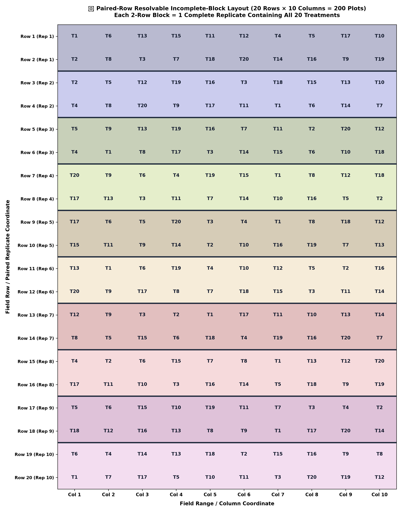
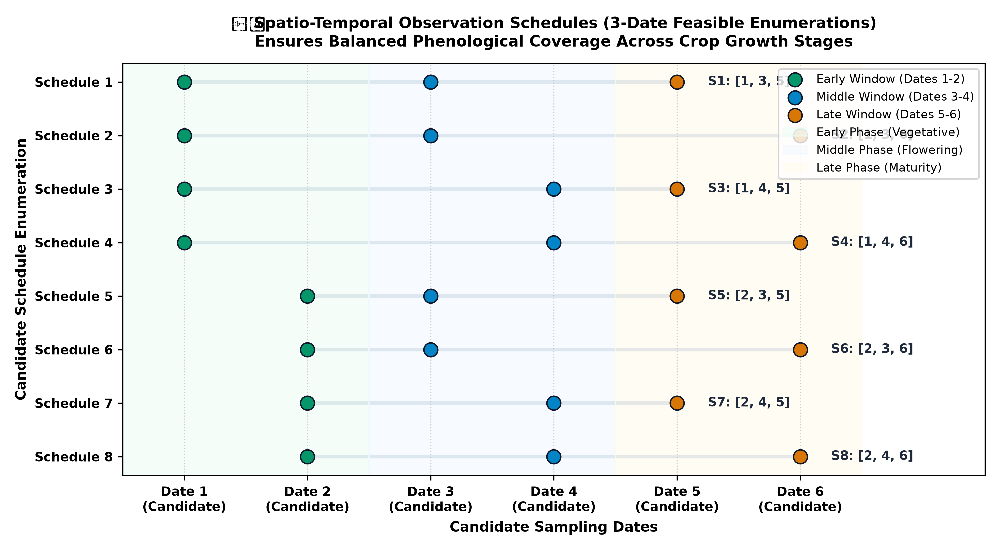
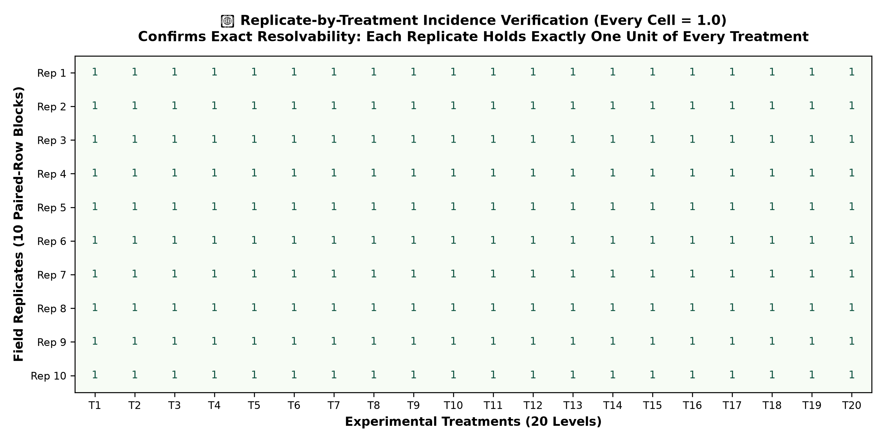

# 🌾 AI/ML Guided Spatio-Temporal Agricultural Experimental Design (`aimlsptm`)

[](https://www.r-project.org/)
[](COPYING)
[](https://iasri.icar.gov.in/)
[](plots/interactive_fieldbook.html)
[](https://github.com/lunganlungpg)

Research repository and R package (`aimlsptm`) for **AI/ML Guided Spatio-Temporal Agricultural Field Experimental Designs**, developed at the **Division of Agricultural Statistics, ICAR–Indian Agricultural Statistics Research Institute (IASRI), New Delhi**.

This work investigates the joint optimization of spatial plot allocation (resolvable incomplete-block layouts) and phenological observation schedules for modern precision agricultural trials.

---

## 📐 Experimental Design Geometry & Visualizations

### 1. Paired-Row Resolvable Incomplete-Block Layout (20 Rows × 10 Columns = 200 Plots)
Each consecutive pair of rows forms one complete, resolvable replicate containing all 20 experimental treatments ($T_1$ through $T_{20}$):



### 2. Spatio-Temporal Observation Schedules (Phenological Window Coverage)
Enumeration of 8 feasible sampling schedules across 6 candidate dates ensuring representation across Early (Vegetative), Middle (Flowering), and Late (Maturity) growth phases:



### 3. Replicate-by-Treatment Incidence Verification (Orthogonal Balance)
Diagnostic confirmation demonstrating exact resolvability — every treatment appears exactly once per 2-row block:



---

## 🌐 Interactive Fieldbook Exploration (Plotly HTML)

Explore the 200-plot agricultural layout interactively in your browser:

👉 **[Interactive 200-Plot Field Map](plots/interactive_fieldbook.html)**
* Hover over any plot cell to inspect its exact spatial coordinates (Row, Column), paired-row replicate ID, and assigned treatment level ($T_1$ to $T_{20}$).
* Zoom into specific blocks and examine spatial neighbors across ranges.

---

## 📊 Design Parameters & Specifications

| Dimension / Parameter | Specification | Description |
| :--- | :---: | :--- |
| **Grid Geometry** | $20 \text{ Rows} \times 10 \text{ Columns}$ | 200 total experimental field plots |
| **Treatments ($t$)** | 20 Levels | Number of agronomic varieties/management regimes |
| **Replicates ($r$)** | 10 Replicates | Each formed by 2 adjacent field rows ($2 \times 10 = 20$ plots) |
| **Resolvability** | Exact ($\alpha$-resolvable) | Every replicate contains all 20 treatments exactly once |
| **Observation Times** | 3 Dates out of 6 | Sampled from distinct early, middle, and late phenological intervals |
| **Feasible Schedules** | 8 Enumerations | Balanced temporal designs for AUC / growth curve modeling |

---

## 📁 Repository Structure

```text
├── R/
│   ├── layout.R                      # generate_blocks() & validate_layout() implementation
│   ├── times.R                       # choose_times() schedule enumeration
│   └── plot_fieldbook.R              # Fieldbook spatial matrix constructor
├── scripts/
│   └── example.R                     # Reproducible execution generating baseline fieldbook
├── plots/
│   ├── field_layout_heatmap.png      # 300 DPI high-resolution fieldbook grid map
│   ├── temporal_sampling_schedules.png# Phenological observation schedules timeline
│   ├── treatment_balance_diagnostic.png# Replicate x Treatment incidence matrix
│   └── interactive_fieldbook.html    # Standalone interactive Plotly field map
├── python/
│   └── generate_field_visuals.py     # Python visualization and interactive generator
├── outputs/
│   ├── baseline-fieldbook.csv        # Validated 200-plot experimental fieldbook
│   ├── candidate-schedules.csv       # 8 feasible spatio-temporal measurement schedules
│   └── session-info.txt              # R session reproducibility record
├── docs/
│   ├── orw/                          # Outline of Research Work (ORW) source documents
│   ├── research-plan.md              # Research objectives and milestone roadmap
│   └── data-management.md            # Data provenance and reproducibility protocols
├── tests/                            # Comprehensive testthat verification suite
├── DESCRIPTION                       # R package metadata
└── README.md
```

---

## 🚀 Quickstart & Execution

### Option A: Direct R Execution
Clone and run the reproducible research script from the repository root:
```bash
git clone https://github.com/lunganlungpg/aiml_sp-tm.git
cd aiml_sp-tm
Rscript scripts/example.R
```

### Option B: Install as an R Package
```r
# Straight from GitHub (no clone needed):
install.packages("remotes")
remotes::install_github("lunganlungpg/aiml_sp-tm")

# ...or from a local clone:  devtools::install()

# Load and generate designs
library(aimlsptm)
set.seed(2026)
field_layout <- generate_blocks(rows = 20, columns = 10)
validate_layout(field_layout)

# Enumerate 3-date observation schedules
schedules <- choose_times(1:6)
print(schedules)
```

### Option B2: Docker Image (GitHub Packages)
A ready-to-run image with R and `aimlsptm` preinstalled is published to
[GitHub Packages](https://github.com/lunganlungpg/aiml_sp-tm/pkgs/container/aiml_sp-tm)
by [`.github/workflows/publish-packages.yml`](.github/workflows/publish-packages.yml):
```bash
docker run --rm ghcr.io/lunganlungpg/aiml_sp-tm                       # runs scripts/example.R
docker run --rm -v "$PWD/outputs:/opt/aiml_sp-tm/outputs" ghcr.io/lunganlungpg/aiml_sp-tm   # keep the fieldbook CSVs
docker run --rm -it ghcr.io/lunganlungpg/aiml_sp-tm R                 # interactive R session
```

### Option C: Regenerate Figures & Interactive Field Maps (Python)
```bash
python python/generate_field_visuals.py
```

---

## 🔬 Research Objectives & Theoretical Scope

1. **Spatial Layout Optimization**: Formulating resolvable spatial experimental designs that account for continuous 2D soil fertility gradients and micro-climatic trends.
2. **Joint Temporal Sampling**: Determining measurement times that minimize variance in non-linear growth curves and trajectory estimation under field logistics constraints.
3. **Spatio-Temporal Mixed Models**: Integrating spatial covariance structures ($\text{AR}(1) \times \text{AR}(1)$, Matérn) with temporal repeated-measures splines.
4. **Software Infrastructure**: Providing reproducible, open-source R tooling for the agricultural statistics and breeding community.

---

## 📄 License & Attribution
* **Software Code**: Licensed under the [GNU General Public License v3.0 (GPL-3)](COPYING).
* **Research Documentation**: Authored research of Lunganlung P G, ICAR–Indian Agricultural Statistics Research Institute (IASRI), New Delhi.
